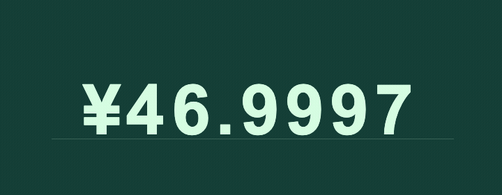

# Codex 额度时钟

在 Mac 上看 Codex 本周还剩多少额度，以及照现在的用量，到重置时会用得太快还是太慢。主面板把实际用量和按时间均匀消耗的进度画在同一根条上。例如，一周过半时已用 30%，就比均匀进度慢了 20 个百分点。

- **周额度与近五小时用量**　每五分钟同步一次，绘制本周用量曲线。Pro 100 面板用同一周内的累计读数估算最近五小时的用量，记录不足时显示已观测的部分。
- **订阅费分摊**　可填写实际人民币月费。按「月费 × 12 ÷ 52」换算每周成本，分别显示已用额度对应的金额和随时间累积的金额。
- **桌面与菜单栏**　提供小号和中号 WidgetKit 小组件。菜单栏读数和桌面实时金额卡都可以单独开关。接电时，实时卡上的新数字从上方落下，逐位击飞旧数字；使用电池或开启“减弱动态效果”时简化显示。



克隆后在浏览器打开 [互动动效演示](demo/index.html)，可以切换击飞力度或慢速重播。演示使用虚构金额。

## 在自己的 Mac 上运行

需要 macOS 14 或更新版本、带 macOS SDK 的 Xcode 开发工具、Python 3，以及钥匙串中带私钥和 Team ID 的 Apple Development 签名证书。主程序和 Widget 扩展使用同一签名团队的 App Group 共享本机数据。

先在 Mac 上安装并登录 Codex。程序会在 /Applications 下的 ChatGPT 或 Codex 应用中查找内置 CLI，也支持 Homebrew 常用的安装位置。

```sh
git clone https://github.com/ljtdsjtw/codex-quota-clock.git
cd codex-quota-clock
./build.sh
open "$HOME/Applications/Codex 额度时钟.app"
```

如果钥匙串里有多张开发证书，可以从下面命令的输出中复制目标证书的 SHA-1，再运行构建脚本。

```sh
security find-identity -v -p codesigning
QUOTA_SIGN_IDENTITY="<证书 SHA-1>" ./build.sh
```

首次打开后点击「刷新」。在桌面右键选择「编辑小组件」，搜索「Codex 周额度」。主程序运行时会持续采样，小组件从最近的数据刷新。

## 读数口径

- 周用量来自已登录的本地 Codex CLI，通过 app-server 的 `account/rateLimits/read` 读取。用量历史和小组件快照存放在 Mac 上的 App Group 容器中。
- Pro 100 的 Plus 周额度对照按约 10 倍估算，依据为原标准 5 倍及 2026 年 10 月 29 日的额度调整。此倍率写在 `Shared.swift` 中，套餐变化后需要更新。[OpenAI 套餐更新记录](https://help.openai.com/en/articles/6825453-chatgpt-release-notes)
- 最近五小时的数字以当前套餐的周额度为单位。Plus 自身的五小时窗口从上一窗口结束后的首条消息起算，两者分母和起点不同。[OpenAI 用量说明](https://help.openai.com/en/articles/20001516-managing-usage-with-gpt-6-astra-in-work-and-codex)

独立开发的 macOS 工具，采用 [MIT 许可证](LICENSE)。
